<p align="center">
  <picture>
    <source media="(prefers-color-scheme: dark)" srcset="docs/assets/logo-dark.svg">
    
  </picture>
</p>

<p align="center">
  <b>A self-hostable, multi-user workspace for writing, planning and thinking together.</b><br>
  Live documents, databases, mind maps, drawings and charts, an AI layer, and a Factory that turns your specs into working apps.
</p>

<p align="center">
  
  
  
  
  
  
</p>

---

Ymer (it shares its name with the giant of Norse myth from whose body the world was shaped) aims to be one place for
collaborative documents, Notion-style notebooks and databases, mind maps, drawings, charts and file handling,
with an optional AI layer on top. Everything collaborative is live: two people on the same page see each other's
edits, cursors and selections as they happen. On top of that, the Factory turns the pages a team writes into a
working app, one reviewed stage at a time. Ymer is built in phases; this README separates what runs today from
what is planned.

<p align="center">
  
  <br><sub>Alice and Bob editing the same page. Bob's cursor is live, and Alice's comment is anchored to the highlighted text.</sub>
</p>

## What works today

### Collaborative documents

| Feature | What you get |
|---|---|
| **Live editing** | TipTap rich-text editor (headings, lists, task lists, quotes, code, links) synced through Yjs, with presence avatars and named cursors. Viewers and commenters get read-only connections. |
| **Comments** | Threads with replies, anchored to a text range that follows edits. Resolve, reopen, delete. |
| **Version history** | Automatic snapshots every 10 minutes while people edit, plus named versions. Preview and restore without losing the current state. Works for documents, mind maps and drawings. |
| **Files** | Image and file uploads into S3-compatible storage, served through short-lived presigned URLs after a permission check. |
| **Page links** | Type `@` to link a page; every page lists its backlinks. |

<p align="center">
  
  <br><sub>Version history: named versions and automatic snapshots.</sub>
</p>

### Notebooks and databases

| Feature | What you get |
|---|---|
| **Databases** | Notion-style databases with title, text, number, select, multi-select, date, checkbox, URL and person properties. |
| **Views** | Table, board and chart views, each with its own filters and sorts (and grouping for boards). Drag rows and cards to reorder. |
| **Relations and rollups** | One- or two-way relations between databases, with count, sum, average, min, max and percent-checked rollups. |
| **Search** | Ctrl/Cmd+K searches page titles, document text, mind map ideas, drawing text and database rows, with typo tolerance. Results only show what you may see. |
| **Page tree and sharing** | Drag pages to nest and reorder them. Share a page by email and manage members and roles. |

<p align="center">
  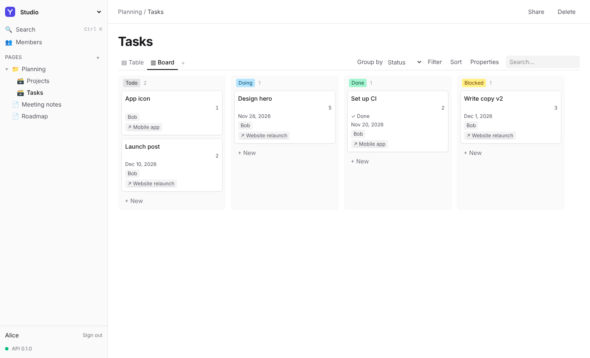
  <br><sub>A database as a board, grouped by a select property.</sub>
</p>

<table>
  <tr>
    <td width="50%">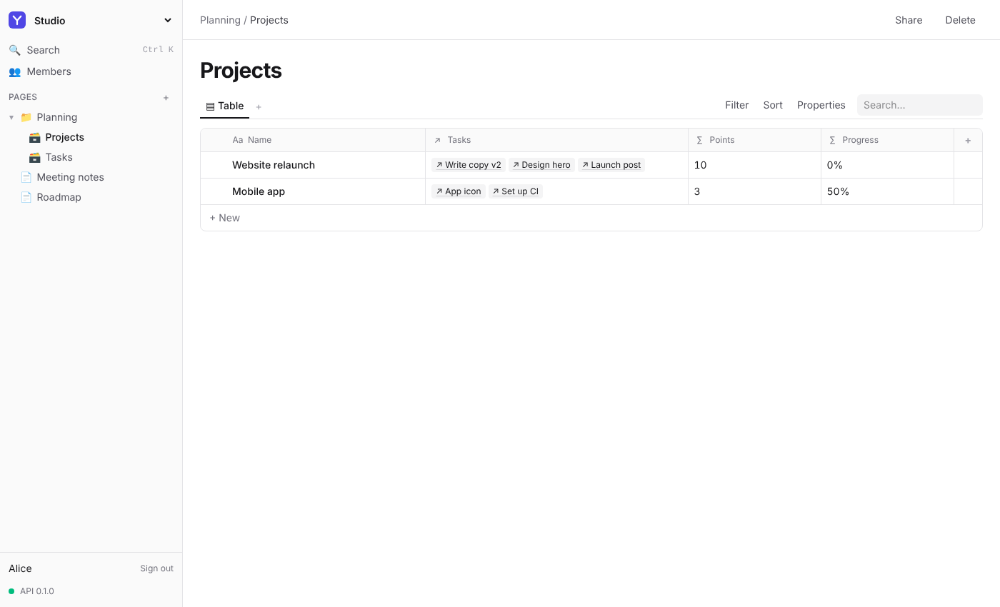</td>
    <td width="50%">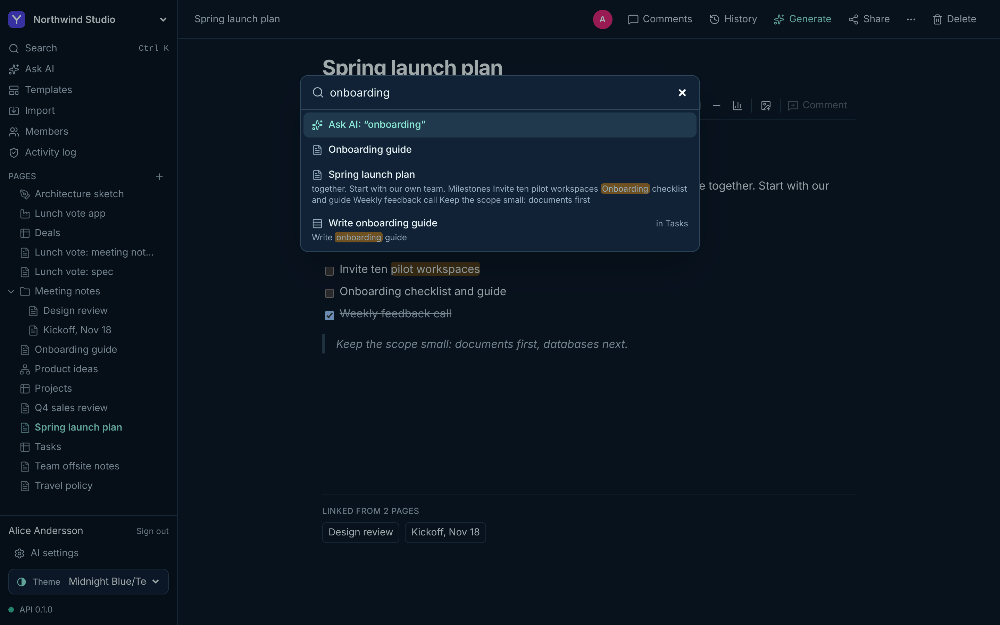</td>
  </tr>
  <tr>
    <td align="center"><sub>Relations and rollups between two databases.</sub></td>
    <td align="center"><sub>Search across pages and rows.</sub></td>
  </tr>
</table>

### Mind maps, drawings and charts

| Feature | What you get |
|---|---|
| **Mind maps** | React Flow canvas over Yjs, so several people edit one map at once and see who has which idea selected. Build it from the keyboard (Tab for a child, Enter for a sibling, F2 or just type to rename, arrows to move around), drag a branch to move it with everything under it, drop an idea onto another to re-parent it, tidy the layout in one click, colour branches, undo your own changes. Ideas can link to pages and show up in their backlinks. |
| **Drawings** | An Excalidraw whiteboard per page, live between everyone on it, with each person's pointer and name. Shapes, arrows, text and freehand; export to PNG or SVG. Text in drawings is searchable. |
| **Chart views** | Turn any database view into a bar, horizontal bar, line, area, pie or doughnut chart. Group by any property (dates by day, week, month, quarter or year), count rows or sum, average, min or max a number, split into series, stack, or show a running total. The view's filters apply. |
| **Chart blocks** | Drop a chart of any database into a document (📊 in the toolbar). It redraws as the rows change, and readers without access to the database see a notice instead. Every chart has a "Show data" table. |

<p align="center">
  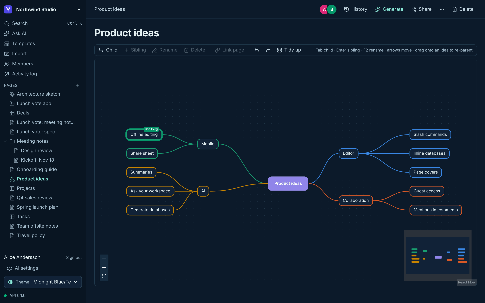
  <br><sub>A mind map edited by two people: Alice's selection is ringed, Bob's idea carries his name.</sub>
</p>

<p align="center">
  
  <br><sub>A shared drawing: Bob sees Alice's pointer while she sketches.</sub>
</p>

<table>
  <tr>
    <td width="50%">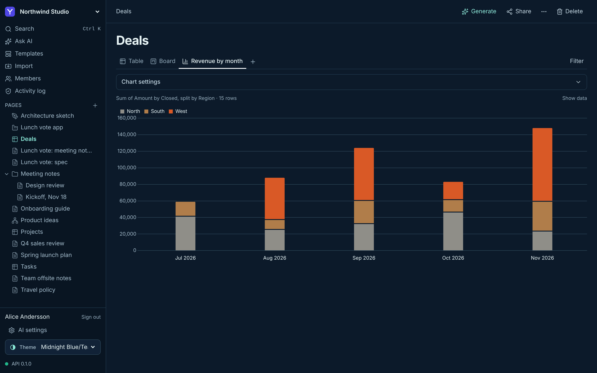</td>
    <td width="50%"></td>
  </tr>
  <tr>
    <td align="center"><sub>A chart view: sum of deal amounts per month, split by region.</sub></td>
    <td align="center"><sub>A chart block in a document, drawn from the same database.</sub></td>
  </tr>
</table>

### AI layer

Open **AI settings** beside your account name in the workspace sidebar. Choose Anthropic,
OpenAI, xAI, Gemini or Venice.ai, enter the exact chat model ID available to your account,
and save your API key. Your choice follows you across workspaces. Each provider remembers its
own model and key. Leave the key blank to keep it, enter a new key to replace it, or choose
**Server default** to switch back. Saving settings makes no provider call. AI requests send
the relevant content to your selected provider and may incur charges.

Ymer encrypts personal keys before saving them. For a manual installation, set a stable
random `YMER_AI_CREDENTIAL_SECRET` (generate one with `openssl rand -hex 32`) on the API and
Factory worker. Otherwise Ymer derives the key from `YMER_SECRET_KEY` (minimum 32 characters).
Back up the secret separately from the database. Changing it requires users to re-enter their keys.
Existing installations need the database migration (`make migrate`). Embeddings use the server
configuration. Setting `YMER_AI_PROVIDER=off` disables chat for everyone. Factory code builds
support Anthropic and the server demo. Structured generation requires a compatible model.

| Feature | What you get |
|---|---|
| **Writing assist** | ✨ AI in the editor toolbar. Select text and improve it, fix spelling and grammar, shorten, expand, summarize, turn it into bullets, or give your own instruction. You see the result first, then replace the selection, insert it below, or copy it. With nothing selected, anyone who can read the page can summarize it. |
| **Generate from notes** | ✨ Generate in a page's header turns that page (or notes you paste) into a new mind map or a new database, created inside the page. Databases get typed properties, select options with colours, a table view and a board view. |
| **Semantic search** | Ctrl/Cmd+K adds a *Related by meaning* section under the keyword results: pages and database rows that match what you meant, even without the same words. |
| **Workspace Q&A** | ✨ Ask AI answers questions from your pages and rows, with numbered citations that link to each source. Follow-up questions keep the context. Conversations are private to the person who asked. |
| **Permissions first** | Everything the AI reads goes through the same permission checks as the rest of the app: search hits, answer sources and summaries only use pages you can open, and rewriting needs edit access. |
| **Pluggable models** | Claude through the Anthropic API, any OpenAI-compatible server (hosted, or local such as Ollama or vLLM), or a built-in offline demo model that needs no key. Embeddings are configured separately, and a background worker keeps them current. |

<table>
  <tr>
    <td width="50%">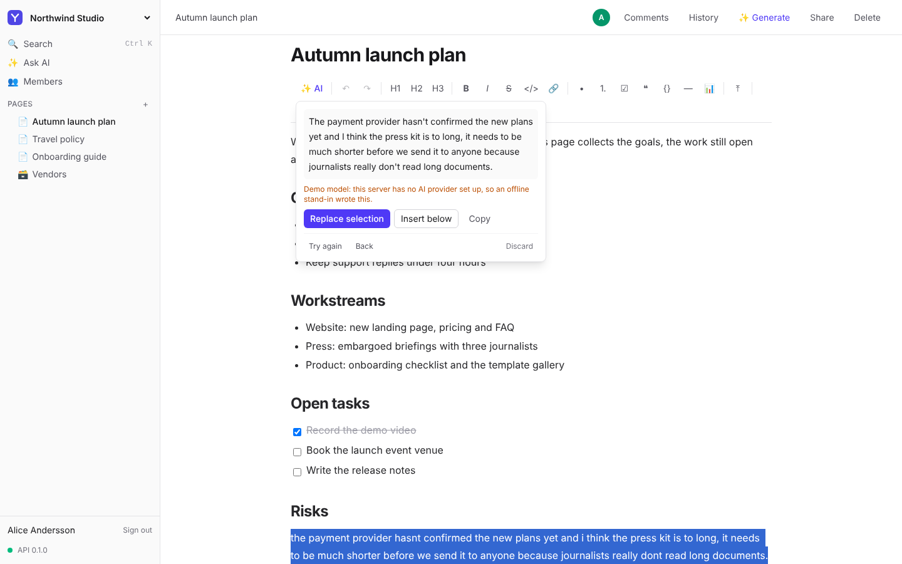</td>
    <td width="50%">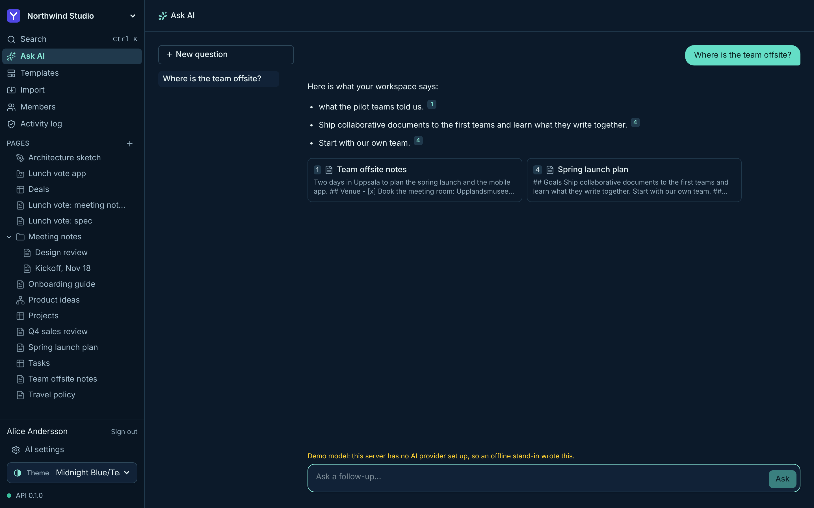</td>
  </tr>
  <tr>
    <td align="center"><sub>Writing assist: review the rewrite, then replace or insert it.</sub></td>
    <td align="center"><sub>Workspace Q&A with citations that link to each source.</sub></td>
  </tr>
  <tr>
    <td width="50%">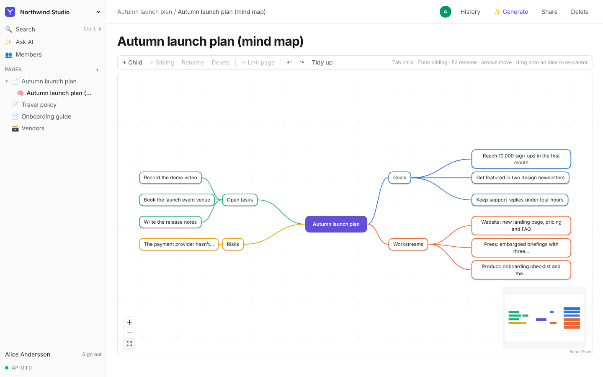</td>
    <td width="50%">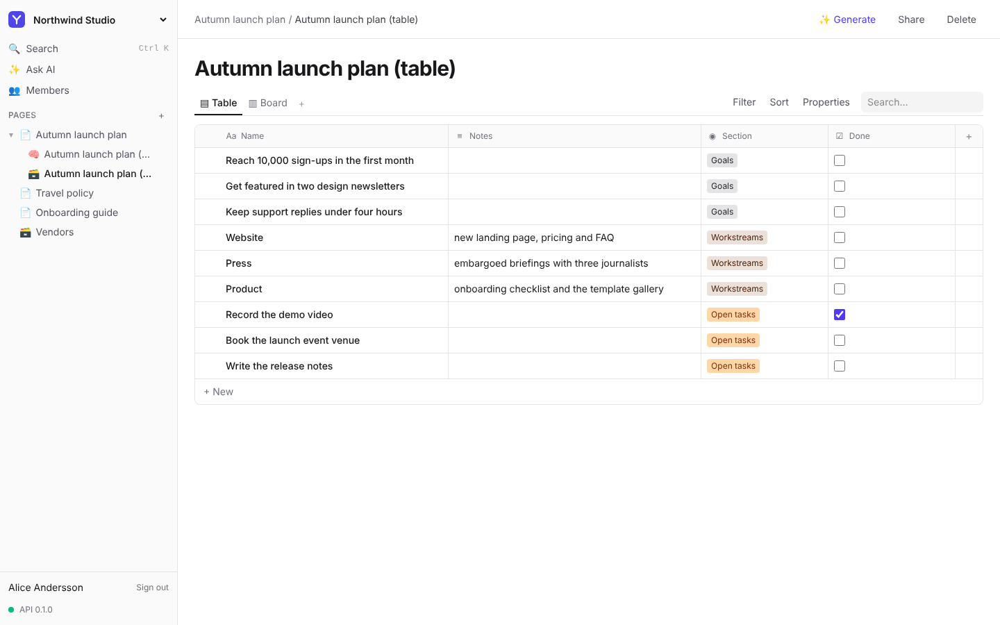</td>
  </tr>
  <tr>
    <td align="center"><sub>A mind map generated from a page of notes.</sub></td>
    <td align="center"><sub>A database generated from the same notes.</sub></td>
  </tr>
</table>

<p align="center">
  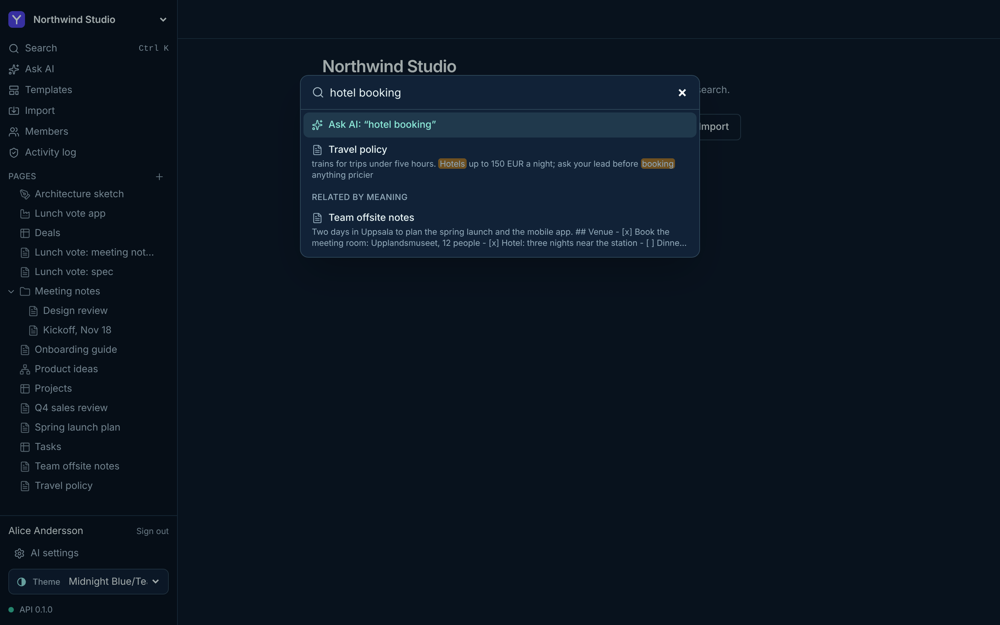
  <br><sub>Search finds pages related by meaning, under the keyword matches.</sub>
</p>

> The screenshots use the offline demo model, which is why its output is simple and marked "Demo model". Set
> `YMER_AI_PROVIDER=anthropic` (or `openai`) and a key to use a real model.

### Factory

The Factory turns what your team writes in Ymer into a working app, one reviewed stage at a time:
brief, architecture, build, review and delivery, and then changes to the delivered app, which go through the
same build and review into the next release.

| Feature | What you get |
|---|---|
| **Factory pages** | A new page type (🏭). Pick the pages to build from: specs, notes, requirement tables, mind maps, sketches. Sources are read with your own access, so a page you cannot open is left out. |
| **The brief** | The AI writes a brief as an ordinary document under the factory: summary, users, features by priority, constraints, out of scope, decisions and links to the sources. Edit it like any page. Rewriting keeps the earlier draft. |
| **Questions** | What the sources do not say (who uses it, where it runs, what it stores, sign-in) comes back as questions. Answer them or mark them not needed, and the next brief includes your answers as decisions. |
| **Approval** | An editor approves the brief once no questions are open. The approved text is saved as a named version, and the brief is frozen until someone reopens it. |
| **Architecture** | From the approved brief, the AI picks one of five stacks (static web tool, Python command-line tool, Node.js command-line tool, FastAPI JSON API, Flask + React web app), or uses the one you choose, and designs the app: an Architecture document (stack, components, data model, interfaces, risks), a System map mind map, and a Tasks database with status, component, priority, size and dependencies, shown as a table and a board. An editor approves the plan; redesigning keeps earlier drafts. |
| **Build** | An AI agent works through the approved tasks in order. For each one it reads the files so far, writes code and tests, runs the tests in a sandbox, and marks the task Done in the Tasks database when they pass. Follow it in a live log, stop it at any time, and browse the files it wrote. A build stops at the first task it cannot finish, and the next build picks up from there. |
| **Review and release** | When a build passes, the page lists the files it added, changed and removed since the last release. An editor adds release notes and approves it as release 1, 2, 3... A release is a frozen copy, so later builds never change what was approved. |
| **Deliver** | Download a release as a zip, with a `RELEASE.md` on how to run it, a `.gitignore` and, for apps that run in a container, a `Dockerfile`. Preview a web app right on the page. Push a release to a GitHub, GitLab, Bitbucket or Codeberg repository: Ymer adds one commit on top of the branch, never force-pushes, and uses your token for that push only. |
| **Change requests** | Once the plan is approved, anyone who can edit asks for changes on the factory page, with a title and details. When a source page is edited after the brief, the factory notices, shows which pages changed, and turns the edits into change requests for you. |
| **Rebuild only what changed** | Planning turns open change requests into new tasks at the end of the Tasks database. Tasks already Done stay Done, so the next build works only on the new ones, starting from the files the last build left. The review then shows what changed, and the release lists the requests it includes, also in its `RELEASE.md`. |
| **Budgets** | Every workspace has a monthly token budget for builds (20 million tokens unless the server sets another default). The build step shows how much is used. Workspace owners can raise, lower or remove the limit; when it runs out, builds stop and say why. |
| **Sandbox** | Code the AI writes never runs inside Ymer. Each command runs in a throwaway Docker container with no network, a read-only system, no privileges, and limits on memory, CPU, processes and time. Builds also have budgets for steps and tokens. In development a demo sandbox checks the files without running anything. |

<table>
  <tr>
    <td width="50%">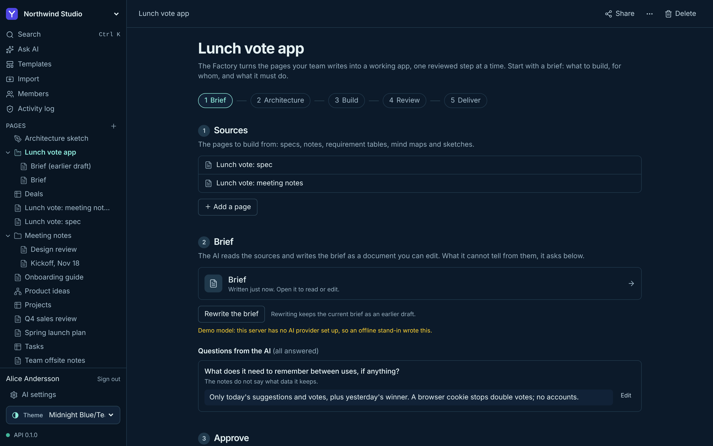</td>
    <td width="50%">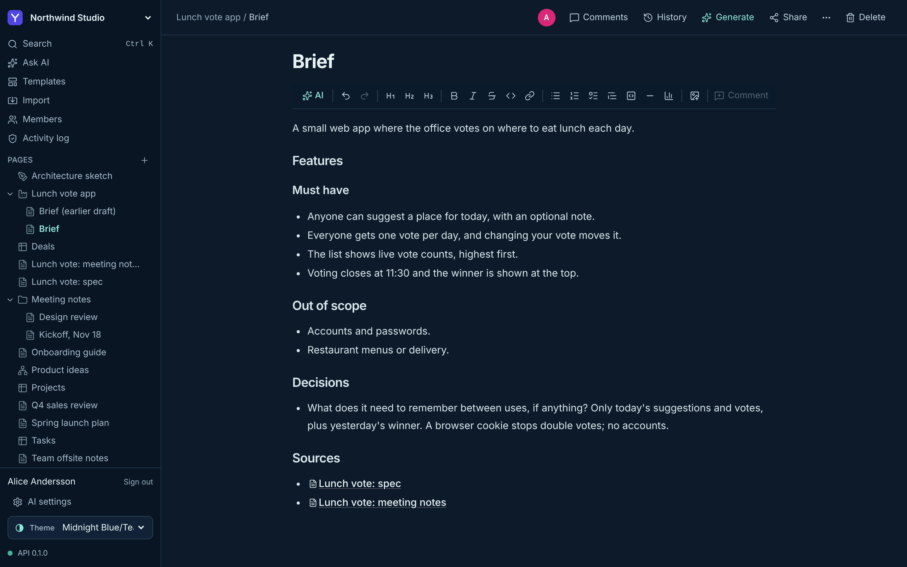</td>
  </tr>
  <tr>
    <td align="center"><sub>A factory: sources, the brief and the AI's questions.</sub></td>
    <td align="center"><sub>The brief it wrote, as an editable document.</sub></td>
  </tr>
  <tr>
    <td width="50%">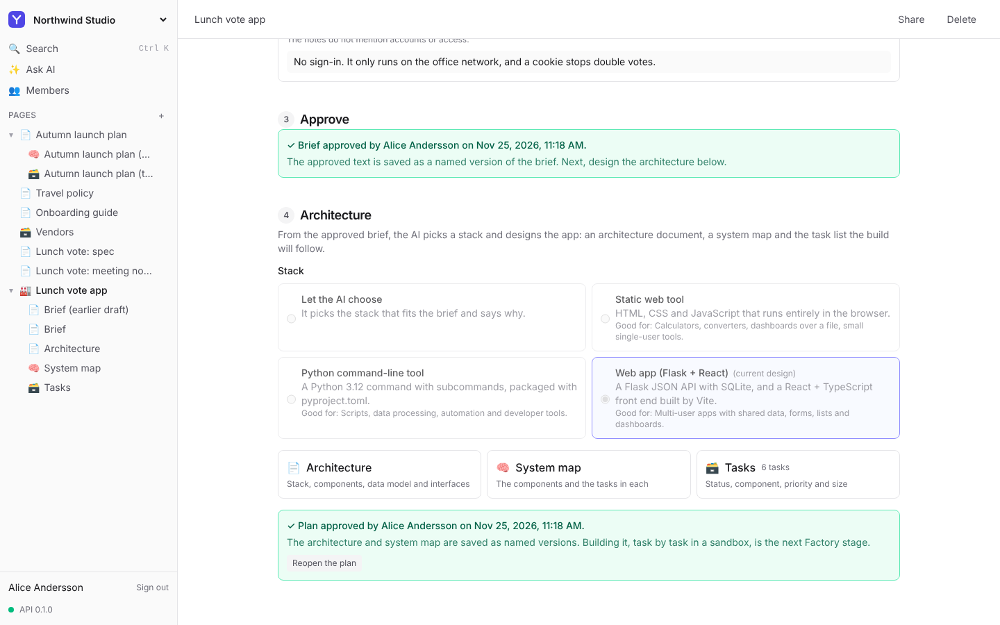</td>
    <td width="50%">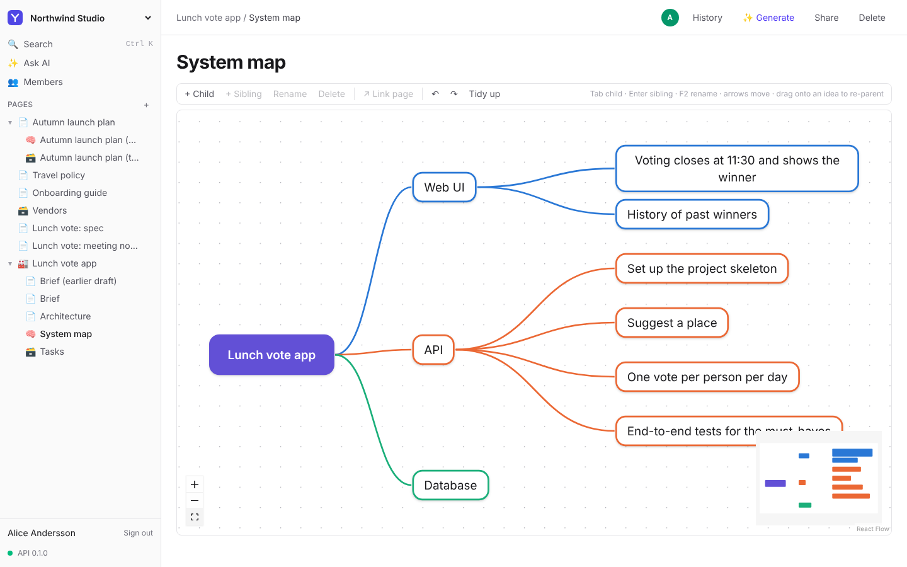</td>
  </tr>
  <tr>
    <td align="center"><sub>The architecture step, with the plan approved.</sub></td>
    <td align="center"><sub>The system map it drew: components and their tasks.</sub></td>
  </tr>
</table>

<p align="center">
  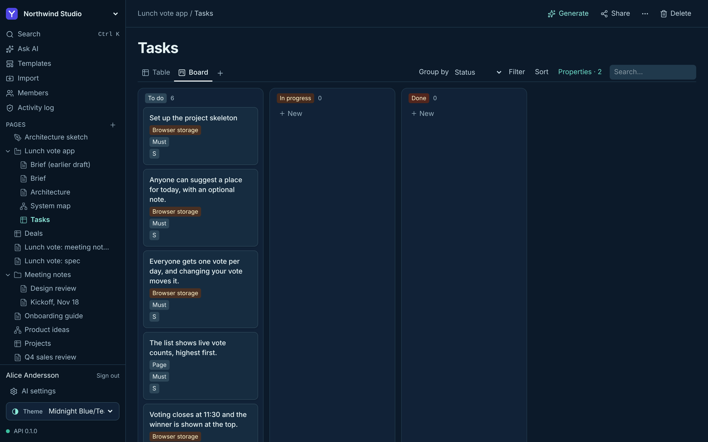
  <br><sub>The plan's tasks, ready for the build stage: a database like any other, shown as a board.</sub>
</p>

<table>
  <tr>
    <td width="50%">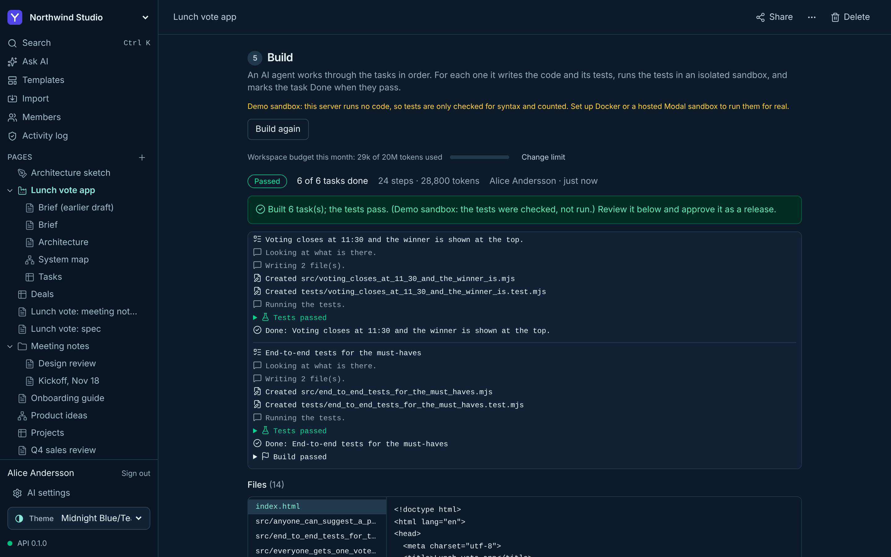</td>
    <td width="50%">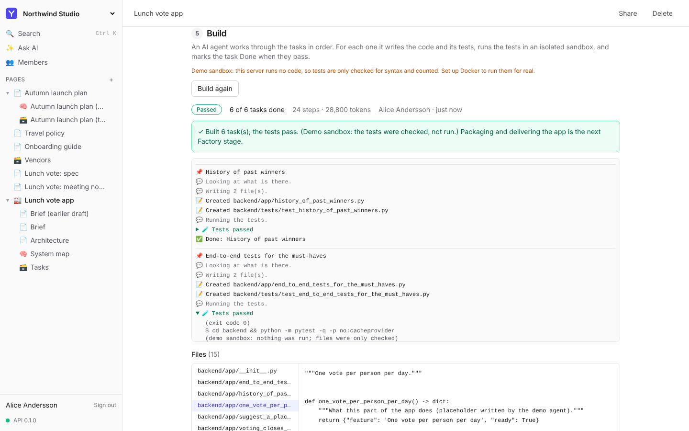</td>
  </tr>
  <tr>
    <td align="center"><sub>A finished build and its log, task by task.</sub></td>
    <td align="center"><sub>The files it wrote, in the file browser.</sub></td>
  </tr>
</table>

<p align="center">
  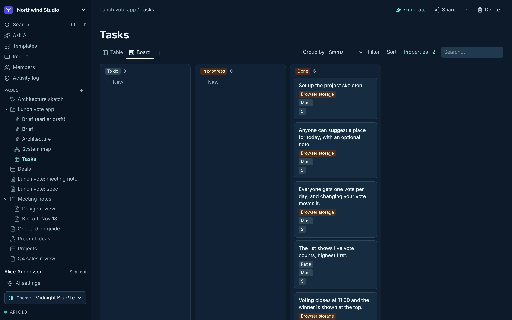
  <br><sub>After the build, every task has moved to Done.</sub>
</p>

<table>
  <tr>
    <td width="50%">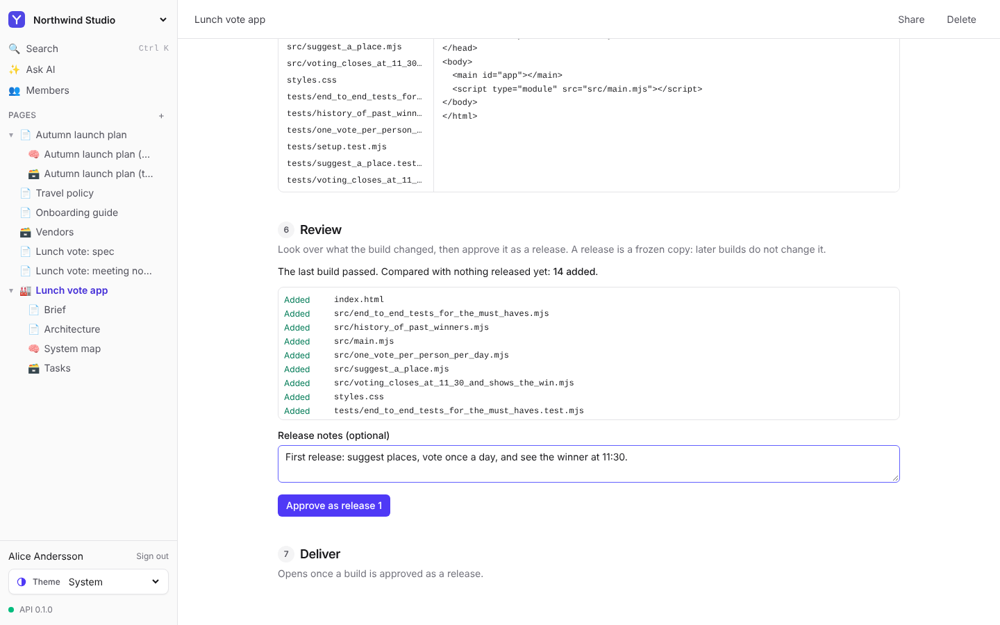</td>
    <td width="50%">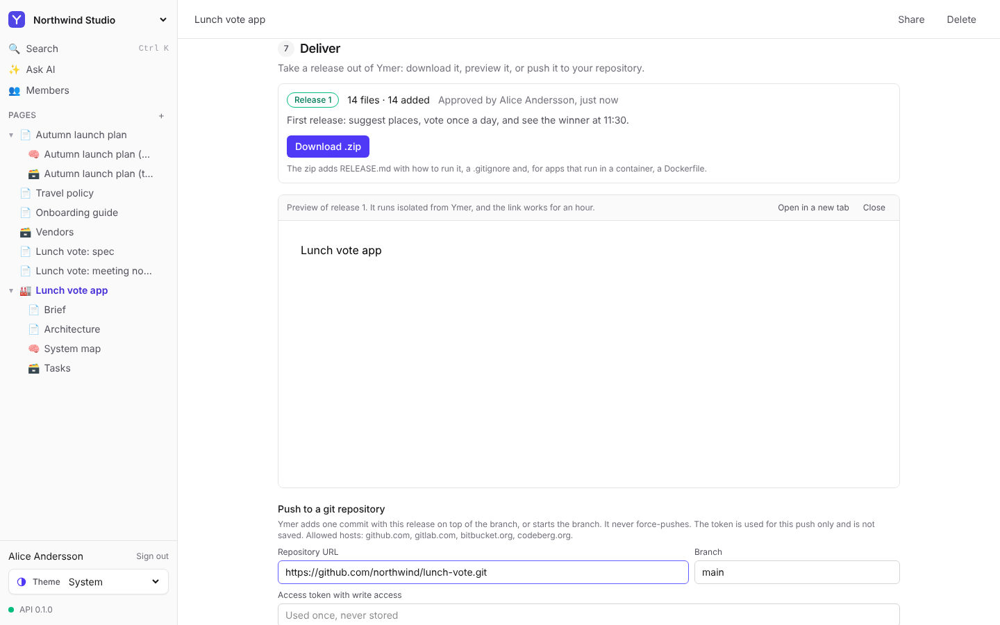</td>
  </tr>
  <tr>
    <td align="center"><sub>Review what changed, then approve it as a release.</sub></td>
    <td align="center"><sub>Download it, preview it, or push it to your repository.</sub></td>
  </tr>
</table>

<table>
  <tr>
    <td width="50%">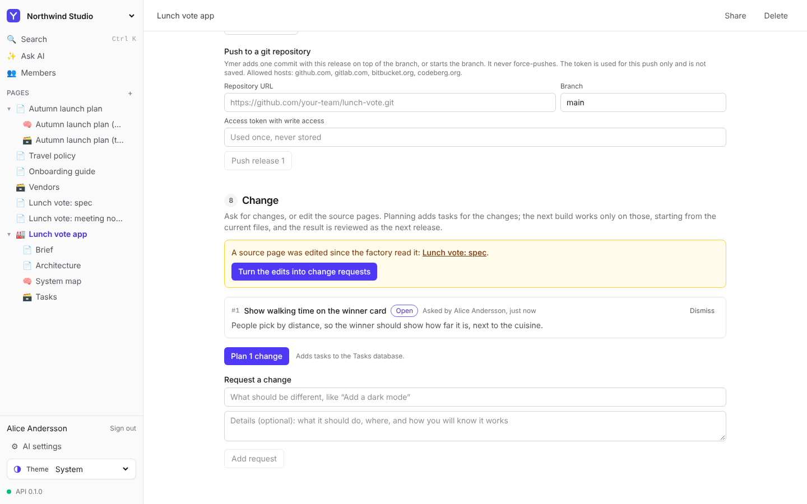</td>
    <td width="50%">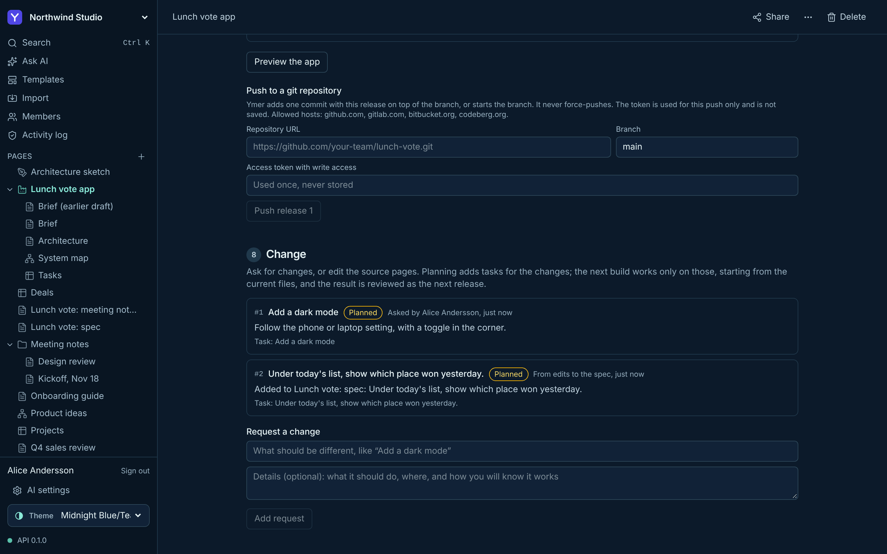</td>
  </tr>
  <tr>
    <td align="center"><sub>The spec was edited after release 1, and someone asked for a change.</sub></td>
    <td align="center"><sub>Both requests, planned as new tasks.</sub></td>
  </tr>
  <tr>
    <td width="50%">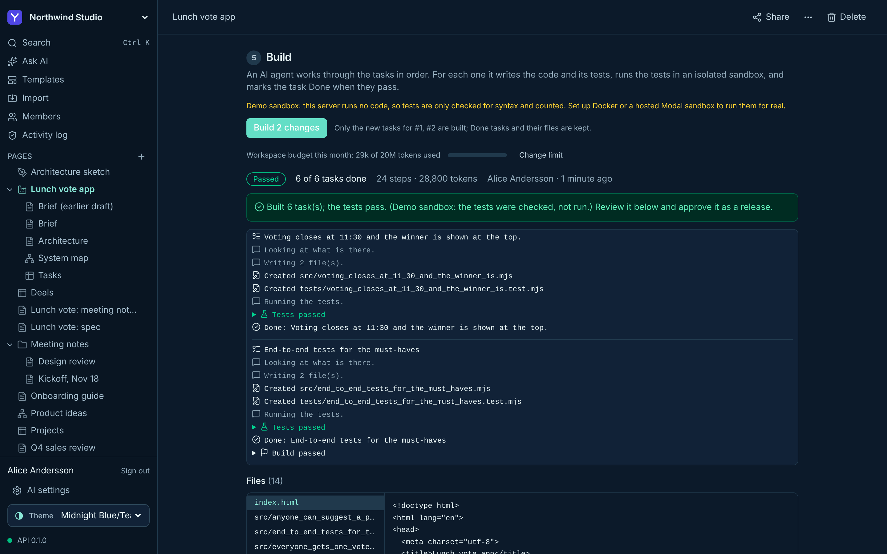</td>
    <td width="50%">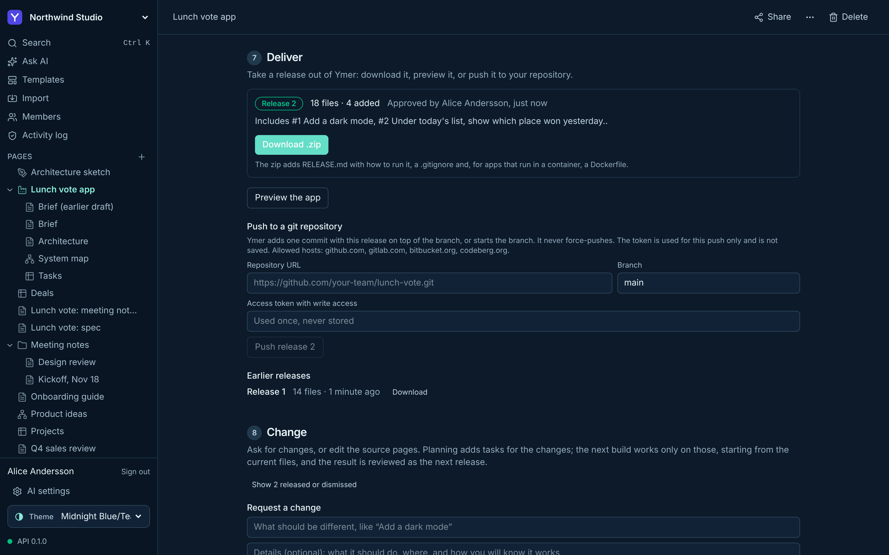</td>
  </tr>
  <tr>
    <td align="center"><sub>Only the new tasks are built, within the workspace's budget.</sub></td>
    <td align="center"><sub>Release 2 lists the changes it includes.</sub></td>
  </tr>
</table>

> These screenshots use the demo model and the demo sandbox, so the code is placeholder and the tests were checked
> rather than run. With `YMER_AI_PROVIDER=anthropic` and `YMER_FACTORY_SANDBOX=docker` the agent writes real code
> and the tests really run.

### Appearance

Choose System, Light, Dark, Darcula, Midnight Blue/Teal or GitHub Dark from the Theme picker at the bottom of the
workspace sidebar. On a phone, open the navigation menu to find it. System follows your device, the choice applies
to every page type (documents, canvases, charts and the Factory), and this browser remembers it across visits.

<p align="center">
  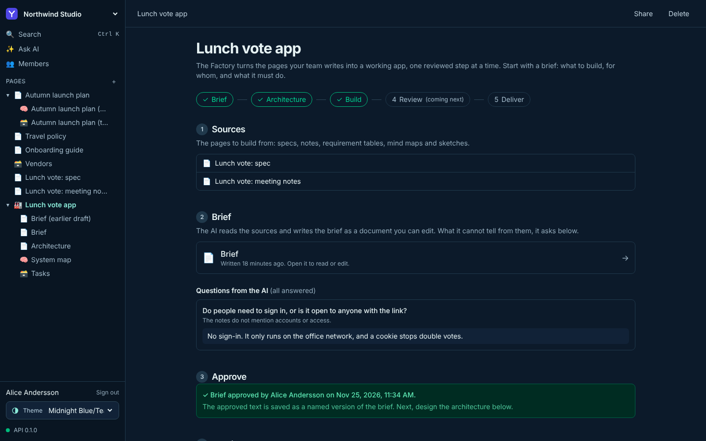
  <br><sub>The Midnight Blue/Teal theme, picked at the bottom of the sidebar.</sub>
</p>

### Phones and offline

Ymer works on a phone and keeps working without a network. Install it from the browser ("Add to Home Screen" or
"Install app") and it opens like an app, full screen with its own icon.

| Feature | What you get |
|---|---|
| **Phone layout** | The sidebar becomes a slide-in menu, page actions shrink to icons, long titles wrap, and controls that only showed on hover are always visible on touch screens. Panels (comments, history) open full screen. |
| **Installable app** | A web app manifest and a service worker. The app shell is cached on first visit, so Ymer starts offline; when a new version is out, a prompt offers to reload. |
| **Offline editing** | Every document, mind map and drawing you open keeps a copy on the device (IndexedDB). Offline, those pages open and stay editable; when the connection comes back, Yjs merges your edits with everyone else's. Pages with edits that have not reached the server yet are pushed in the background, even if you closed them, and the sidebar counts them until they have. |
| **Offline reading** | The sidebar's page list and other pages' details come from the last answer the server gave, so you can find your way around. A page never opened on this device says so instead of showing an empty copy. |
| **Privacy** | Signing out deletes every offline copy and the cached responses (it warns first if edits have not synced). Signing in as someone else on the same browser deletes the previous user's copies. Sign-out needs a connection, so the server really ends the session. |

<table>
  <tr>
    <td width="50%">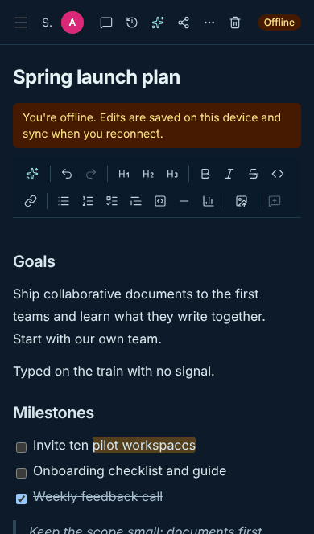</td>
    <td width="50%">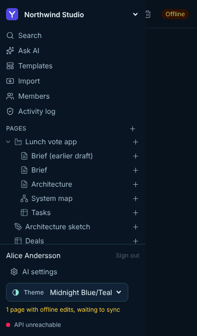</td>
  </tr>
  <tr>
    <td><sub>Editing on a phone with no network. The edit is saved on the device.</sub></td>
    <td><sub>The page list still works offline, and the menu counts pages waiting to sync.</sub></td>
  </tr>
</table>

Offline support needs the production build (the service worker is not registered by the dev server) and HTTPS, or
localhost. Databases, comments, uploads, search and AI still need a connection; changes there wait until you are
back online.

### Foundation

| Area | What you get |
|---|---|
| **Accounts and workspaces** | Email/password sign-up, workspaces with members and roles (owner, editor, commenter, viewer). The browser's session lives in httpOnly cookies that page scripts cannot read, with CSRF protection; scripts and other API clients can still use bearer tokens. |
| **Security** | Rate limits on sign-in (per address and per account), sign-up, uploads, git pushes and the whole API. An audit log of sign-ins, member and sharing changes, deletions, uploads and Factory builds, releases and pushes, which owners read under **Activity log** in the sidebar. |
| **Permissions** | Per-page grants that inherit down the tree and can widen access for guests or narrow it for members. Every query is workspace-scoped; no access answers 404, never 403. |
| **Dev stack** | Docker Compose with Postgres 16 (pgvector and pg_trgm), Redis 7 and MinIO; a `make` target for each service, the AI worker, the Factory worker and the sandbox images; tests for backend, collab service and frontend. |

<p align="center">
  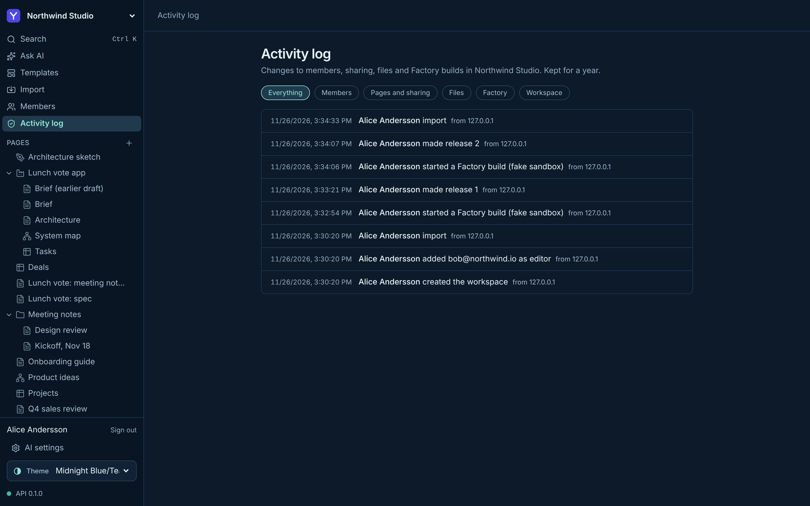
  <br><sub>Owners see who changed what under Activity log.</sub>
</p>

## Architecture

<p align="center">
  
</p>

- **Frontend** (`frontend/`): Vite, React 18, TypeScript, Tailwind CSS 4, TipTap 3, React Flow 12, Excalidraw,
  Chart.js 4, React Query, react-router 7. Themes are CSS variables chosen per palette (`src/lib/appearance.ts`).
  A Workbox service worker (vite-plugin-pwa) caches the app and recent API reads; y-indexeddb keeps each opened
  page's Yjs document on the device (`src/offline/`).
- **API** (`backend/`): Flask 3, SQLAlchemy 2, Alembic, pydantic. It is the only writer of the schema and the only place
  that decides permissions.
- **Realtime** (`collab/`): a small Hocuspocus service on Node 22. One Yjs room per page, whether the page is a
  document, a mind map or a drawing. It asks Flask whether a user may open a page and loads and saves state through
  Flask's internal API, so it never touches Postgres itself. Flask decodes each save (pycrdt) to refresh search text
  and backlinks.
- **Storage**: Postgres for everything structured (Yjs state, versions, comments, databases, full-text search),
  MinIO (any S3 API) for file bytes. Redis holds the rate limit counters.
- **AI layer** (`backend/ymer/ai/`): part of the Flask app, not a separate service. Flask proxies every model call,
  uses saved keys server-side, and applies workspace permissions to each read. Pages and database rows are
  split into chunks and embedded into pgvector; edits put the page on a queue that `make ai-worker` (`flask
  ai-worker`) drains in the background. The chat model and the embedding model are configured separately with
  `YMER_AI_*` settings.
- **Factory builds** (`backend/ymer/factory/`): queued in Postgres and run by `make factory-worker` (`flask
  factory-worker`), one build per worker. The agent talks to the model over tool use and runs code only through a
  sandbox interface: Docker containers today (`YMER_FACTORY_SANDBOX=docker`, images from `make factory-images`),
  with room for a hosted sandbox later.

Deeper notes on each part (routes, settings, the permission rules, how collab storage works) are in
[DEVELOPMENT.md](DEVELOPMENT.md).

## Quick start

From the repository root, run the local development installer with Python 3.12+, Node.js 22.18+, npm, curl, and a running Docker engine with Compose v2.

```sh
./install.sh
```

The installer prepares the Python environment, installs both Node projects, starts the infrastructure, applies migrations, and waits for the application to respond. It preserves an existing `.env`. Press Ctrl+C to stop the application processes. Run `docker compose stop` when you also want to stop the infrastructure. For dependency installation alone, use `./install.sh --install-only`. The [development guide](DEVELOPMENT.md) covers running services individually.

Open http://localhost:5173, create an account, then a workspace. The **+** next to *Pages* creates a document,
database, mind map, drawing, folder or factory. To see live editing, sign up a second user in a private window, add them to
the workspace under *Members*, and open the same page in both windows.

AI features work out of the box with the offline demo model (`YMER_AI_PROVIDER=fake`), which needs no key and
writes simple, clearly labelled stand-in output. `.env.example` also indexes pages as they are saved, so the worker
is optional in development. To use Claude, set `YMER_AI_PROVIDER=anthropic` and `YMER_AI_API_KEY`; for an
OpenAI-compatible server (including local ones) set `YMER_AI_PROVIDER=openai`, `YMER_AI_BASE_URL` and
`YMER_AI_MODEL`. Claude has no embeddings API, so semantic search uses `YMER_AI_EMBEDDING_PROVIDER` (`fake` for a
built-in hashing embedder, or `openai` for any OpenAI-compatible embeddings endpoint). After changing the embedding
model, run `flask --app wsgi ai-reindex` (from `backend/`) to rebuild the index. Factory builds use the demo
sandbox by default; to run the code they write, set
`YMER_FACTORY_SANDBOX=docker` and rerun the installer. It calls `make factory-images` when this mode is enabled. [DEVELOPMENT.md](DEVELOPMENT.md) lists every setting.

`curl localhost:5000/api/health/ready` should report `database`, `redis` and `storage` as `ok`.
`make test` runs all test suites and `make lint` the linters and type checks. `make help` lists every target.

> **Note:** on some Docker Compose versions `make infra-up` exits with an error once the one-shot `minio-init`
> container finishes, even though every service is healthy. Check with `docker compose ps` and carry on with
> `make migrate`.

## Repository layout

```
backend/     Flask API (Python package `ymer`), models, Alembic migrations, pytest suite
collab/      Hocuspocus realtime service (TypeScript, run directly by Node 22)
frontend/    React app: app shell and page tree, editor (src/editor), databases (src/database),
             mind maps (src/mindmap), drawings (src/drawing), charts (src/charts), AI (src/ai), Factory (src/factory)
infra/       Init scripts for the Compose services, and the Factory's sandbox images (infra/factory)
docs/assets/ Logo, architecture diagram and screenshots used in this README
```

## Roadmap

| Phase | Scope | Status |
|---|---|---|
| **0. Foundation** | Monorepo and dev stack, auth, workspaces and roles, page tree and permissions, layout shell | ✅ Done |
| **1. Collaborative documents** | TipTap + Yjs editing with presence and cursors, comments, version history, file uploads | ✅ Done |
| **2. Notebooks and databases** | Page hierarchy and backlinks, database engine (properties, rows, table and board views), relations and rollups, full-text search, sharing | ✅ Done |
| **3. Mind maps and visuals** | Collaborative React Flow mind maps, Excalidraw drawings, chart views and chart blocks from database data | ✅ Done |
| **4. AI layer** | Pluggable LLM proxy (hosted or local models), summarize / rewrite / expand on a selection, generate mind maps or databases from notes, workspace Q&A over pgvector, background jobs | ✅ Done |
| **F1. Factory: brief** | Factory pages, source pages, AI brief with open questions, answers and approval | ✅ Done |
| **F2. Factory: architecture** | Pick a stack; generate an architecture document, a system mind map and a task database; approve them | ✅ Done |
| **F3. Factory: build** | Locked-down sandboxes, an agent loop that writes code and runs tests, a live run log and file browser | ✅ Done |
| **F4. Factory: deliver** | Review and numbered releases, zip download with packaging files (Dockerfile where it fits), isolated preview of web apps, push to a git repository | ✅ Done |
| **F5. Factory: iterate** | Change requests from reviews and from spec edits, rebuilding only the new tasks, Node.js CLI and FastAPI stacks, monthly budgets per workspace | ✅ Done |
| **H. Hardening** | Sessions in httpOnly cookies with CSRF protection, rate limits, an audit log with an Activity log page, the Docker sandbox, MinIO uploads and git pushes checked against real services | ✅ Done |
| **M. Mobile and offline** | Phone layout, installable app (manifest, service worker), offline editing with local Yjs copies and background resync, offline start-up | ✅ Done |
| **5. Polish** | Presence everywhere, public sharing links, export (Markdown, PDF, PNG), templates and import, a hosted build sandbox | Planned |

### Data model

Today's schema: `users`, `workspaces`, `workspace_members`, `pages` (document, database, mindmap, drawing, folder,
factory), `page_permissions`, `page_links`, `document_content` and `document_versions` (Yjs state for every live
page type), `comments`, `files`, `database_properties`, `database_rows`, `database_relations` and `database_views`
(table, board, chart), and for the AI layer `ai_chunks` (text chunks with pgvector embeddings), `ai_index_queue` (pages waiting to be
re-embedded), `ai_conversations` and `ai_messages`, and for the Factory `factory_projects`, `factory_sources`,
`factory_questions`, `factory_runs`, `factory_run_events`, `factory_files`, `factory_releases`,
`factory_pushes` and `factory_changes`, and `audit_events` for the audit log. Mind maps and drawings need no
tables of their own: they are Yjs documents like the rest ([DEVELOPMENT.md](DEVELOPMENT.md) describes their format).

Phase 5 will add, roughly, tables for public links. This is a sketch and will change when the phase is designed.

## Design principles

- **Yjs (CRDT) for anything collaborative.** Documents, mind maps and drawings all go through one collab service.
- **One authority.** Flask decides every permission and owns the schema; other services ask it.
- **Workspace-scoped everything.** Every read goes through a scope object filtered by workspace, and tests cover the rules.
- **Untrusted code stays out.** Code the Factory's agent writes runs only in a sandbox, never in the Ymer process,
  and model output is cleaned and capped before it is stored.
- **People approve each step.** The AI drafts; editors approve the brief and the plan before anything is built, and
  each release before it leaves Ymer. Pushes to git use a token for that push only and never rewrite history.
- **Postgres first.** pg_trgm and full-text search before adding a search engine; JSONB before a document store.
- **Swappable AI.** All model calls go behind one service, so providers or local models can be swapped.
- **Self-hosting friendly.** Every dependency has an open-source, container-friendly option.
