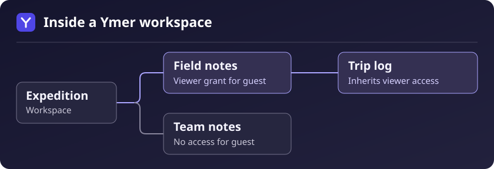
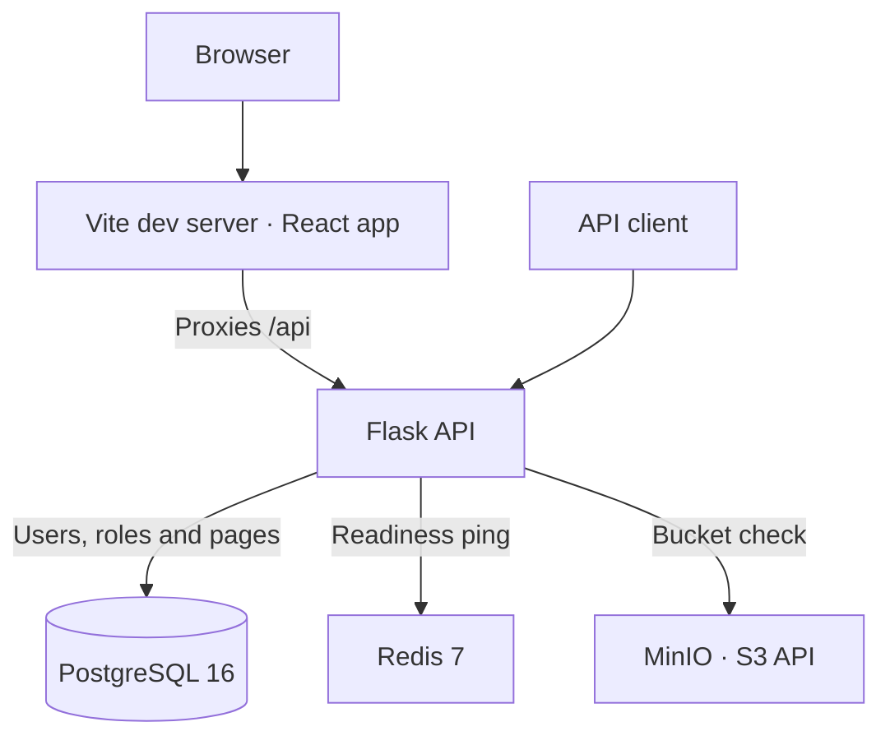

# Ymer

Ymer is a multi-user workspace for organizing creative work around a shared tree of pages. The goal is to keep a team's notes, documents, structured data, mind maps, and files together, with control over who can see or edit each branch.

Today you can use the Flask API to create a workspace, build its page tree, and share a folder with another user. The React app opens to a workspace shell with an API status indicator. The sidebar previews the planned editors.



## How sharing works

In the Expedition example above, the team can give a guest access to *Field notes* without adding them as a workspace member. A new page under *Field notes* inherits the grant. A query for the guest's visible pages includes *Trip log* and omits *Team notes*.

For each page, Ymer uses the closest grant it finds, starting at the page and walking up through its parents. If it finds none, it uses the user's workspace role. Workspace owners retain owner access throughout the tree. The API returns the effective role as `my_role` on each visible page. [Permission rules](backend/ymer/permissions.py) · [Permission tests](backend/tests/test_permissions.py)

## What you can use today

| Area | Available on `main` |
| --- | --- |
| Accounts | Register with an email and password, sign in, refresh a JWT access token, and sign out across sessions. |
| Workspaces | Create and rename workspaces. Owners manage members with owner, editor, commenter, or viewer roles. |
| Pages | Create, list, rename, reorder, move, and delete pages. Each page has a type (`document`, `database`, `mindmap`, or `folder`), a position, and an optional parent in the same workspace. |
| Sharing | Grant an existing user access to a page and its descendants. A closer grant can widen or narrow access on a particular branch. |
| Web app | Open the Home shell and see whether the API is reachable. Workspace and page operations are available through the API. |

## Run locally

Install Git, Make, Python 3.12+, uv, Node.js 22+ with npm, and Docker with Compose v2. From a terminal, clone the repository and start the API:

```sh
git clone https://github.com/MKlolbullen/Ymer.git
cd Ymer
make setup
make infra-up
make migrate
make backend
```

In a second terminal, run `make frontend` from the same repository directory and open [localhost:5173](http://localhost:5173). The status indicator reads the version from Flask. To check the database, cache service, and storage bucket as well, run:

```sh
curl -fsS http://localhost:5000/api/health/ready
```

Look for `"status": "ok"` for each of `database`, `redis`, and `storage`. For configuration, test setup, and migration commands, see the [development guide](DEVELOPMENT.md).

## How the local stack fits together



Flask and Vite run on the host. Docker Compose runs PostgreSQL, Redis, and MinIO. SQLAlchemy models and Alembic migrations define the workspace data in PostgreSQL. [API routes](backend/ymer/api) · [Data model](backend/ymer/models) · [Compose services](docker-compose.yml)

## Where the project is headed

The four page types already share a hierarchy and permission model. The roadmap adds the tools for working with their contents:

- **Collaborative documents** — rich-text editing, live cursors, comments, version history, and file attachments.
- **Notebooks and databases** — a navigable page tree, searchable notes, typed properties, and table and board views.
- **Mind maps and visuals** — a shared canvas for connected ideas, drawings, and charts embedded in pages.
- **AI-assisted work** — summarize a selection, turn notes into a mind map, or ask questions across a workspace.
- **Sharing and portability** — public links, exports, offline editing, and an audit trail.
