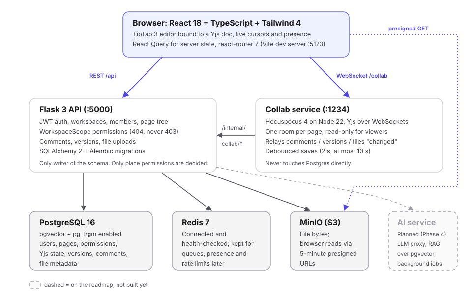

<p align="center">
  <picture>
    <source media="(prefers-color-scheme: dark)" srcset="docs/assets/logo-dark.svg">
    
  </picture>
</p>

<p align="center">
  <b>A self-hostable, multi-user workspace for writing, planning and thinking together.</b><br>
  Collaborative documents today; notebooks, databases, mind maps and an AI layer on the roadmap.
</p>

<p align="center">
  
  
  
  
</p>

---

Ymer (it shares its name with the giant of Norse myth from whose body the world was shaped) aims to be one place for
collaborative documents, Notion-style notebooks and databases, mind maps, charts and file handling, with
an optional AI layer on top. It is built in phases; this README separates what runs today from what is planned.

<p align="center">
  
  <br><sub>Alice and Bob editing the same page. Bob's cursor is live, and Alice's comment is anchored to the highlighted text.</sub>
</p>

## What works today

| Area | What you get |
|---|---|
| **Accounts and workspaces** | Email/password sign-up, JWT access and refresh tokens, workspaces with members and roles (owner, editor, commenter, viewer). |
| **Pages and permissions** | A page tree (documents and folders) per workspace. Per-page grants that inherit down the tree, can widen access for guests or narrow it for members. Every query is workspace-scoped; no access answers 404, never 403. |
| **Collaborative documents** | TipTap rich-text editor (headings, lists, task lists, quotes, code, links) synced live through Yjs, with presence avatars and named cursors. Viewers and commenters get read-only connections. |
| **Comments** | Threads with replies, anchored to a text range that follows edits. Resolve, reopen, delete. |
| **Version history** | Automatic snapshots every 10 minutes while people edit, plus named versions. Preview and restore without losing the current state. |
| **Files** | Image and file uploads into S3-compatible storage, served through short-lived presigned URLs after a permission check. |
| **Dev stack** | Docker Compose with Postgres 16 (pgvector and pg_trgm enabled), Redis 7 and MinIO; a `make` target for each service; tests for backend, collab service and frontend. |

<p align="center">
  
  <br><sub>Version history: named versions and automatic snapshots.</sub>
</p>

## Architecture

<p align="center">
  
</p>

- **Frontend** (`frontend/`): Vite, React 18, TypeScript, Tailwind CSS 4, TipTap 3, React Query, react-router 7.
- **API** (`backend/`): Flask 3, SQLAlchemy 2, Alembic, pydantic. It is the only writer of the schema and the only place
  that decides permissions.
- **Realtime** (`collab/`): a small Hocuspocus service on Node 22. One Yjs room per page. It asks Flask whether a user may
  open a page and loads and saves document state through Flask's internal API, so it never touches Postgres itself.
- **Storage**: Postgres for everything structured (including Yjs state, versions and comments), MinIO (any S3 API) for
  file bytes. Redis is connected and health-checked; it is reserved for queues, presence and rate limits in later phases.

Deeper notes on each part (routes, settings, the permission rules, how collab storage works) are in
[DEVELOPMENT.md](DEVELOPMENT.md).

## Quick start

You need Docker with Compose v2, Python 3.12+, [uv](https://docs.astral.sh/uv/) (or plain `pip`) and Node 22.18+.

```sh
make setup       # .env from .env.example, backend venv, npm install for collab and frontend
make infra-up    # Postgres, Redis, MinIO (and creates the `ymer` bucket)
make migrate     # apply database migrations
```

Then run each service in its own terminal:

```sh
make backend     # Flask API on http://localhost:5000
make collab      # collab service on ws://localhost:1234
make frontend    # the app on http://localhost:5173
```

Open http://localhost:5173, create an account, then a workspace and a page. To see live editing, sign up a second
user in a private window, add them to the workspace, and open the same page.

`curl localhost:5000/api/health/ready` should report `database`, `redis` and `storage` as `ok`.
`make test` runs all test suites and `make lint` the linters and type checks. `make help` lists every target.

> **Note:** on some Docker Compose versions `make infra-up` exits with an error once the one-shot `minio-init`
> container finishes, even though every service is healthy. Check with `docker compose ps` and carry on with
> `make migrate`.

## Repository layout

```
backend/     Flask API (Python package `ymer`), models, Alembic migrations, pytest suite
collab/      Hocuspocus realtime service (TypeScript, run directly by Node 22)
frontend/    React app: app shell, page tree, editor, comments and history panels
infra/       Init scripts for the Compose services
docs/assets/ Logo, architecture diagram and screenshots used in this README
```

## Roadmap

| Phase | Scope | Status |
|---|---|---|
| **0. Foundation** | Monorepo and dev stack, auth, workspaces and roles, page tree and permissions, layout shell | ✅ Done |
| **1. Collaborative documents** | TipTap + Yjs editing with presence and cursors, comments, version history, file uploads | ✅ Done |
| **2. Notebooks and databases** | Richer page hierarchy and backlinks, database engine (properties, rows, table and board views), relations and simple rollups, full-text search | ⏭️ Next |
| **3. Mind maps and visuals** | Collaborative React Flow mind maps, chart blocks, drawing canvas (Excalidraw or tldraw) | Planned |
| **4. AI layer** | Pluggable LLM proxy (hosted or local models), summarize / rewrite / expand on a selection, generate mind maps or databases from notes, workspace Q&A over pgvector, background jobs | Planned |
| **5. Polish and hardening** | Presence everywhere, public sharing links, export (Markdown, PDF, PNG), offline-friendly editing, audit logs, rate limiting | Planned |

### Planned data model additions

The schema today covers `users`, `workspaces`, `workspace_members`, `pages`, `page_permissions`, `document_content`,
`document_versions`, `comments` and `files`. Later phases add, roughly:

- `database_properties`, `database_rows` (JSONB properties) and `relations` for Notion-style databases
- mind map state, most likely stored as a Yjs document per page like documents are
- `embeddings` (pgvector) and `ai_conversations` for the AI layer
- `activity_log` for auditing

These are sketches from the original plan and will change as each phase is designed.

## Design principles

- **Yjs (CRDT) for anything collaborative.** Documents use it now; mind maps will reuse the same collab service.
- **One authority.** Flask decides every permission and owns the schema; other services ask it.
- **Workspace-scoped everything.** Every read goes through a scope object filtered by workspace, and tests cover the rules.
- **Postgres first.** pg_trgm and full-text search before adding a search engine; JSONB before a document store.
- **Swappable AI.** All model calls go behind one service, so providers or local models can be swapped.
- **Self-hosting friendly.** Every dependency has an open-source, container-friendly option.
