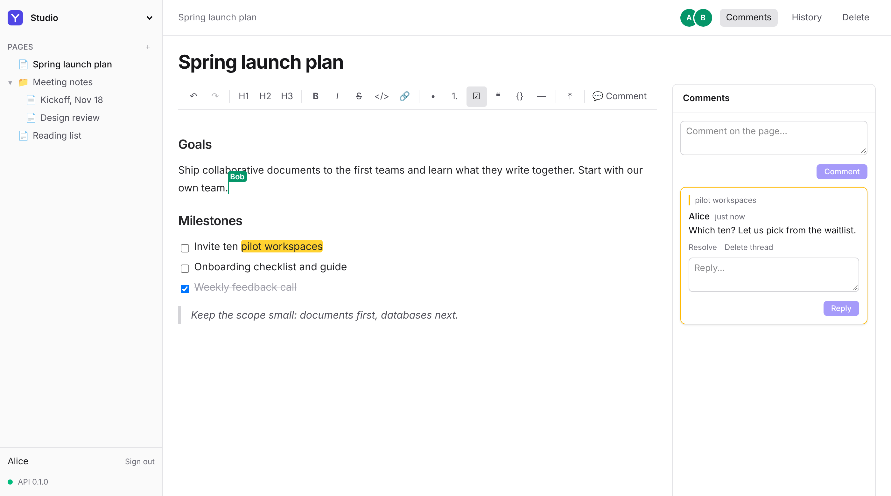
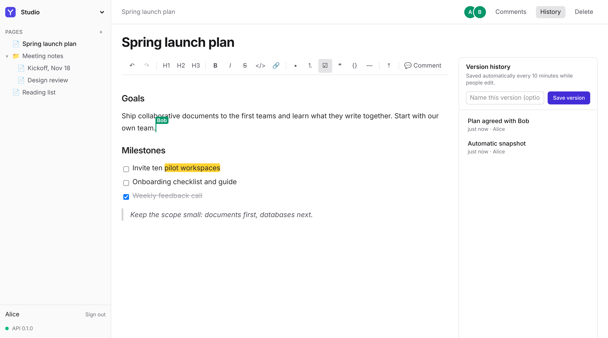
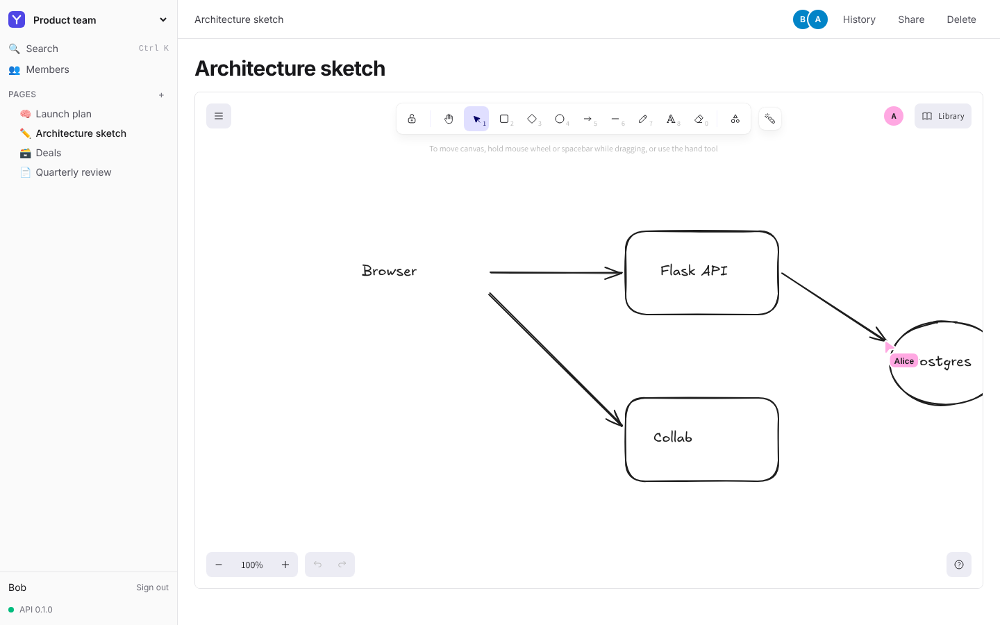
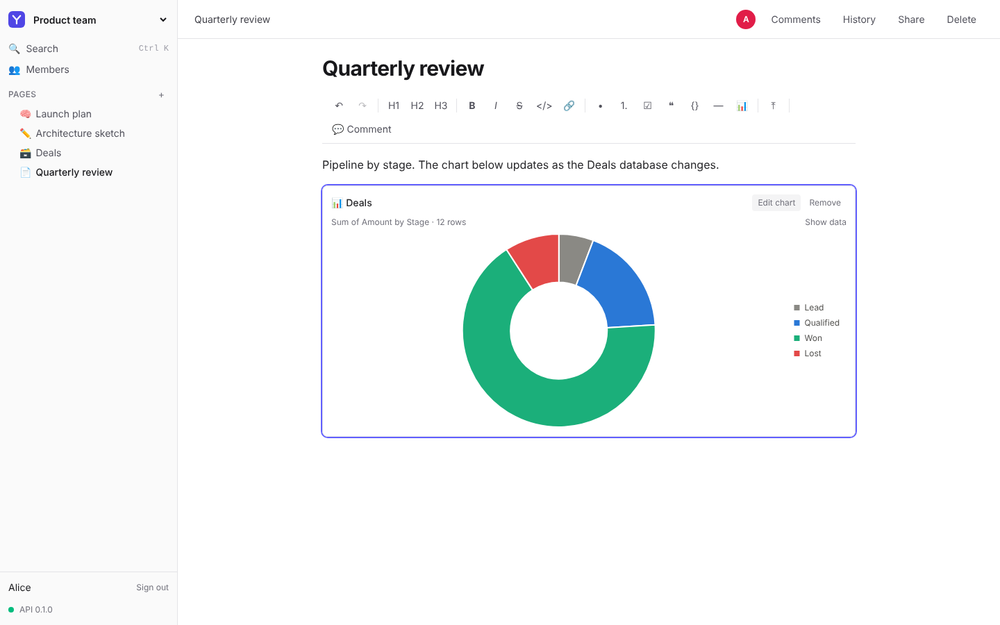

<p align="center">
  <picture>
    <source media="(prefers-color-scheme: dark)" srcset="docs/assets/logo-dark.svg">
    
  </picture>
</p>

<p align="center">
  <b>A self-hostable, multi-user workspace for writing, planning and thinking together.</b><br>
  Live documents, databases, mind maps, drawings and charts today; an AI layer on the roadmap.
</p>

<p align="center">
  
  
  
  
  
</p>

---

Ymer (it shares its name with the giant of Norse myth from whose body the world was shaped) aims to be one place for
collaborative documents, Notion-style notebooks and databases, mind maps, charts and file handling, with
an optional AI layer on top. Everything collaborative is live: two people on the same page see each other's
edits, cursors and selections as they happen. It is built in phases; this README separates what runs today from
what is planned.

<p align="center">
  
  <br><sub>Alice and Bob editing the same page. Bob's cursor is live, and Alice's comment is anchored to the highlighted text.</sub>
</p>

## What works today

### Collaborative documents

| Feature | What you get |
|---|---|
| **Live editing** | TipTap rich-text editor (headings, lists, task lists, quotes, code, links) synced through Yjs, with presence avatars and named cursors. Viewers and commenters get read-only connections. |
| **Comments** | Threads with replies, anchored to a text range that follows edits. Resolve, reopen, delete. |
| **Version history** | Automatic snapshots every 10 minutes while people edit, plus named versions. Preview and restore without losing the current state. Works for documents, mind maps and drawings. |
| **Files** | Image and file uploads into S3-compatible storage, served through short-lived presigned URLs after a permission check. |
| **Page links** | Type `@` to link a page; every page lists its backlinks. |

<p align="center">
  
  <br><sub>Version history: named versions and automatic snapshots.</sub>
</p>

### Notebooks and databases

| Feature | What you get |
|---|---|
| **Databases** | Notion-style databases with title, text, number, select, multi-select, date, checkbox, URL and person properties. |
| **Views** | Table, board and chart views, each with its own filters and sorts (and grouping for boards). Drag rows and cards to reorder. |
| **Relations and rollups** | One- or two-way relations between databases, with count, sum, average, min, max and percent-checked rollups. |
| **Search** | Ctrl/Cmd+K searches page titles, document text, mind map ideas, drawing text and database rows, with typo tolerance. Results only show what you may see. |
| **Page tree and sharing** | Drag pages to nest and reorder them. Share a page by email and manage members and roles. |

<p align="center">
  
  <br><sub>A database as a board, grouped by a select property.</sub>
</p>

<table>
  <tr>
    <td width="50%"></td>
    <td width="50%"></td>
  </tr>
  <tr>
    <td align="center"><sub>Relations and rollups between two databases.</sub></td>
    <td align="center"><sub>Search across pages and rows.</sub></td>
  </tr>
</table>

### Mind maps, drawings and charts

| Feature | What you get |
|---|---|
| **Mind maps** | React Flow canvas over Yjs, so several people edit one map at once and see who has which idea selected. Build it from the keyboard (Tab for a child, Enter for a sibling, F2 or just type to rename, arrows to move around), drag a branch to move it with everything under it, drop an idea onto another to re-parent it, tidy the layout in one click, colour branches, undo your own changes. Ideas can link to pages and show up in their backlinks. |
| **Drawings** | An Excalidraw whiteboard per page, live between everyone on it, with each person's pointer and name. Shapes, arrows, text and freehand; export to PNG or SVG. Text in drawings is searchable. |
| **Chart views** | Turn any database view into a bar, horizontal bar, line, area, pie or doughnut chart. Group by any property (dates by day, week, month, quarter or year), count rows or sum, average, min or max a number, split into series, stack, or show a running total. The view's filters apply. |
| **Chart blocks** | Drop a chart of any database into a document (📊 in the toolbar). It redraws as the rows change, and readers without access to the database see a notice instead. Every chart has a "Show data" table. |

<p align="center">
  
  <br><sub>A mind map edited by two people: Alice's selection is ringed, Bob's idea carries his name.</sub>
</p>

<p align="center">
  
  <br><sub>A shared drawing: Bob sees Alice's pointer while she sketches.</sub>
</p>

<table>
  <tr>
    <td width="50%"></td>
    <td width="50%"></td>
  </tr>
  <tr>
    <td align="center"><sub>A chart view: sum of deal amounts per month, split by region.</sub></td>
    <td align="center"><sub>A chart block in a document, drawn from the same database.</sub></td>
  </tr>
</table>

### Foundation

| Area | What you get |
|---|---|
| **Accounts and workspaces** | Email/password sign-up, JWT access and refresh tokens, workspaces with members and roles (owner, editor, commenter, viewer). |
| **Permissions** | Per-page grants that inherit down the tree and can widen access for guests or narrow it for members. Every query is workspace-scoped; no access answers 404, never 403. |
| **Dev stack** | Docker Compose with Postgres 16 (pgvector and pg_trgm), Redis 7 and MinIO; a `make` target for each service; tests for backend, collab service and frontend. |

## Architecture

<p align="center">
  
</p>

- **Frontend** (`frontend/`): Vite, React 18, TypeScript, Tailwind CSS 4, TipTap 3, React Flow 12, Excalidraw,
  Chart.js 4, React Query, react-router 7.
- **API** (`backend/`): Flask 3, SQLAlchemy 2, Alembic, pydantic. It is the only writer of the schema and the only place
  that decides permissions.
- **Realtime** (`collab/`): a small Hocuspocus service on Node 22. One Yjs room per page, whether the page is a
  document, a mind map or a drawing. It asks Flask whether a user may open a page and loads and saves state through
  Flask's internal API, so it never touches Postgres itself. Flask decodes each save (pycrdt) to refresh search text
  and backlinks.
- **Storage**: Postgres for everything structured (Yjs state, versions, comments, databases, full-text search),
  MinIO (any S3 API) for file bytes. Redis is connected and health-checked; it is reserved for queues, presence and rate limits in later phases.

Deeper notes on each part (routes, settings, the permission rules, how collab storage works) are in
[DEVELOPMENT.md](DEVELOPMENT.md).

## Quick start

You need Docker with Compose v2, Python 3.12+, [uv](https://docs.astral.sh/uv/) (or plain `pip`) and Node 22.18+.

```sh
make setup       # .env from .env.example, backend venv, npm install for collab and frontend
make infra-up    # Postgres, Redis, MinIO (and creates the `ymer` bucket)
make migrate     # apply database migrations
```

Then run each service in its own terminal:

```sh
make backend     # Flask API on http://localhost:5000
make collab      # collab service on ws://localhost:1234
make frontend    # the app on http://localhost:5173
```

Open http://localhost:5173, create an account, then a workspace. The **+** next to *Pages* creates a document,
database, mind map, drawing or folder. To see live editing, sign up a second user in a private window, add them to
the workspace under *Members*, and open the same page in both windows.

`curl localhost:5000/api/health/ready` should report `database`, `redis` and `storage` as `ok`.
`make test` runs all test suites and `make lint` the linters and type checks. `make help` lists every target.

> **Note:** on some Docker Compose versions `make infra-up` exits with an error once the one-shot `minio-init`
> container finishes, even though every service is healthy. Check with `docker compose ps` and carry on with
> `make migrate`.

## Repository layout

```
backend/     Flask API (Python package `ymer`), models, Alembic migrations, pytest suite
collab/      Hocuspocus realtime service (TypeScript, run directly by Node 22)
frontend/    React app: app shell and page tree, editor (src/editor), databases (src/database),
             mind maps (src/mindmap), drawings (src/drawing), charts (src/charts)
infra/       Init scripts for the Compose services
docs/assets/ Logo, architecture diagram and screenshots used in this README
```

## Roadmap

| Phase | Scope | Status |
|---|---|---|
| **0. Foundation** | Monorepo and dev stack, auth, workspaces and roles, page tree and permissions, layout shell | ✅ Done |
| **1. Collaborative documents** | TipTap + Yjs editing with presence and cursors, comments, version history, file uploads | ✅ Done |
| **2. Notebooks and databases** | Page hierarchy and backlinks, database engine (properties, rows, table and board views), relations and rollups, full-text search, sharing | ✅ Done |
| **3. Mind maps and visuals** | Collaborative React Flow mind maps, Excalidraw drawings, chart views and chart blocks from database data | ✅ Done |
| **4. AI layer** | Pluggable LLM proxy (hosted or local models), summarize / rewrite / expand on a selection, generate mind maps or databases from notes, workspace Q&A over pgvector, background jobs | ⏭️ Next |
| **5. Polish and hardening** | Presence everywhere, public sharing links, export (Markdown, PDF, PNG), offline-friendly editing, audit logs, rate limiting | Planned |

### Data model

Today's schema: `users`, `workspaces`, `workspace_members`, `pages` (document, database, mindmap, drawing, folder),
`page_permissions`, `page_links`, `document_content` and `document_versions` (Yjs state for every live page type),
`comments`, `files`, `database_properties`, `database_rows`, `database_relations` and `database_views` (table, board,
chart). Mind maps and drawings need no tables of their own: they are Yjs documents like the rest
([DEVELOPMENT.md](DEVELOPMENT.md) describes their format).

Later phases add, roughly, `embeddings` (pgvector) and `ai_conversations` for the AI layer and `activity_log` for
auditing. These are sketches and will change as each phase is designed.

## Design principles

- **Yjs (CRDT) for anything collaborative.** Documents, mind maps and drawings all go through one collab service.
- **One authority.** Flask decides every permission and owns the schema; other services ask it.
- **Workspace-scoped everything.** Every read goes through a scope object filtered by workspace, and tests cover the rules.
- **Postgres first.** pg_trgm and full-text search before adding a search engine; JSONB before a document store.
- **Swappable AI.** All model calls go behind one service, so providers or local models can be swapped.
- **Self-hosting friendly.** Every dependency has an open-source, container-friendly option.
